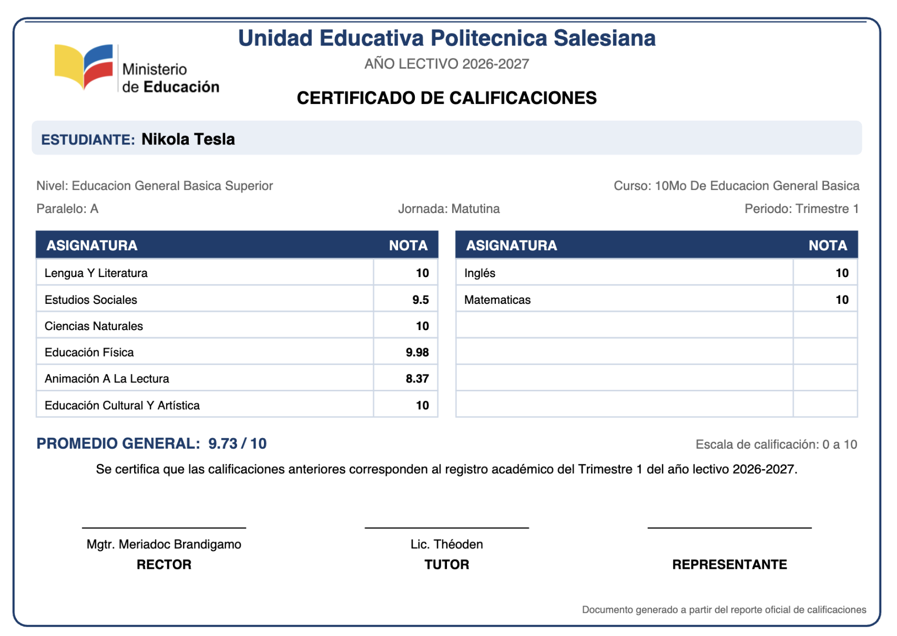

# Project Overview

#### Note

> To use this repository, you need the `Reporte Notas Periodo ....xlsx` file, which you can obtain from your teacher through the [Academico Ecuador](https://academico.educarecuador.gob.ec/).
> Once you have downloaded the file, rename it to `Notas_Demo.xlsx` and run the code.
> A Flask-based web application will be introduced in a future release, with Docker support for easier deployment.

## Step 1. Create Python Virtual Environment

Create and activate a virtual environment, then install the required dependencies:

```bash
python3 -m venv .env
source .env/bin/activate
pip install -r requirements.txt
```
## Step 2. Execute file generator.py

```bash
python generator.py
```

## Results

A file named `CertificadoNotas_Demo.pdf` will be generated, containing academic certificates that list the grades and grade point averages of all students data that must be obtained via the [academico.gob.ec](https://academico.educarecuador.gob.ec/) platform, 
in this case, the resulting file is named `Notas_Demo.xlsx`.

The result is a PDF file containing the academic record of all students, including subjects, grades, and the overall grade point average.


